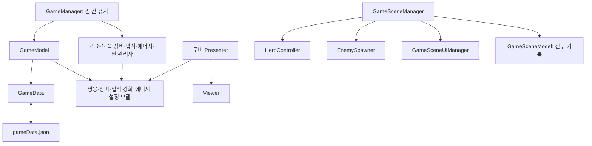
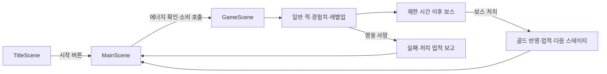

# 2D_RogueLite 기술문서

작성일: 2026-10-22  
대상: 현재 작업 폴더의 C# 소스, 씬, ScriptableObject 에셋 및 프로젝트 설정  
문서 목적: 신규 개발자의 구조 이해, 기능 확장, 구현 상태 점검

> 이 문서는 소스와 직렬화된 에셋을 정적으로 분석한 결과다. Unity 에디터에서의 플레이, 컴파일 및 플랫폼 빌드는 수행하지 않았다. 아래의 ‘구현’은 관련 코드가 존재한다는 의미이며 실행 검증 완료를 뜻하지 않는다. 분석 시작 전부터 변경되어 있던 `Assets/00.Scenes/MainScene.unity`는 수정하지 않았다.

## 1. 프로젝트 개요

Unity 기반 2D 생존형 로그라이트 게임이다. 로비에서 캐릭터 선택, 장비 관리, 영구 능력치 강화를 진행하고, 전투에서는 이동과 자동 공격으로 적을 처치한다. 경험치를 수집해 무기·패시브를 강화하고, 제한 시간 이후 등장하는 보스를 처치하면 다음 스테이지를 개방한다.

성장 데이터는 두 범위로 나뉜다.

| 범위 | 주요 데이터 | 수명 |
|---|---|---|
| 영구 성장 | 재화, 선택 영웅, 장비, 강화, 업적, 스테이지 개방, 에너지, 설정 | `GameData`에 보관하고 JSON으로 저장 |
| 전투 성장 | 현재 HP·경험치·레벨, 무기·패시브 레벨, 전투 골드, 처치 수, 경과 시간 | 전투 씬 객체와 모델에 보관 |

주요 자체 스크립트는 `Assets/01.Scripts`의 C# 파일 162개다. 에셋 패키지의 예제·플러그인 코드는 이 수에 포함하지 않았다.

## 2. 개발 환경과 의존성

| 항목 | 저장소에서 확인한 값 | 근거 |
|---|---|---|
| Unity | 6000.0.69f1 | `ProjectSettings/ProjectVersion.txt` |
| 언어 | C# | `Assets/01.Scripts` |
| 렌더링 | Universal Render Pipeline 17.0.4, 2D 프로젝트 구성 | `Packages/manifest.json`, `ProjectSettings/GraphicsSettings.asset` |
| UI | uGUI 2.0.0, TextMesh Pro 사용 | 패키지 설정 및 UI 스크립트 |
| 카메라 패키지 | Cinemachine 3.1.6 | 패키지 설정; 등록 사실만 확인 |
| 입력 | Input System 1.19.0, `activeInputHandler: 2` | 패키지 및 Player 설정; 기존 Input 호출도 존재 |
| UI 애니메이션 | DOTween | `Assets/Plugins/Demigiant/DOTween`, 메뉴 Presenter |
| 테스트 도구 | Unity Test Framework 1.6.0 | 패키지 설정 |
| 제품명 | `2Droguelite` | `ProjectSettings/ProjectSettings.asset` |

Android 관련 설정이 존재하지만 실제 배포 대상이나 빌드 성공을 보장하지는 않는다. Multiplayer Center 등 설치된 패키지의 존재만으로 네트워크 게임 기능을 제공한다고 판단할 수 없다. 조사한 핵심 게임 흐름은 로컬 데이터 중심이다.

## 3. 디렉터리 안내

```text
Assets/
├─ 00.Scenes/                  TitleScene, MainScene, GameScene
├─ 01.Scripts/
│  ├─ GameManager.cs           전역 서비스 접근점
│  ├─ GameModel.cs             저장 및 영구 모델 구성
│  ├─ GameData.cs              저장 데이터 구조
│  ├─ Achievement/             업적 조건, 진행, 보상, 초기화
│  ├─ AppConfig/               BGM·SFX·데미지 표시 설정
│  ├─ Energy/                  에너지 및 오프라인 회복 계산
│  ├─ Equipment/               장비 인벤토리·장착·강화·정의 조회
│  ├─ Upgrade/                 영구 능력치 강화
│  ├─ MainScene/               로비 UI, 상점, 캐릭터, 합성
│  ├─ GameScene/               전투 진행, UI, 조이스틱
│  │  ├─ Hero/                 영웅 모델·이동·무기·패시브·각성
│  │  ├─ Enemy/                적 생성·상태·보스·적 탄환
│  │  └─ Interface/            피해·아이템·강화·상태 계약
│  ├─ Pool/                    오브젝트 풀
│  └─ ScriptableObject/        게임 설정 데이터 타입
├─ Resources/
│  ├─ GameDatas/               런타임 설정 에셋
│  ├─ Prefabs/                 적·탄환·아이템·UI 프리팹
│  └─ ...                      텍스처·애니메이션·타일맵 등
├─ Plugins/                    DOTween 등
├─ Layer Lab/, Gif/, ...       외부 UI·그래픽 에셋 및 예제
└─ gameData.json               에디터 실행 시 사용하는 저장 파일
Packages/                      패키지 목록과 버전 잠금
ProjectSettings/               Unity 프로젝트 설정
```

## 4. 아키텍처와 초기화

### 4.1 전역 서비스와 모델

`GameManager`는 싱글턴 `MonoBehaviour`다. `Awake()`에서 중복 인스턴스를 제거하고 `DontDestroyOnLoad()`로 유지한다. 같은 GameObject의 다음 컴포넌트를 가져와 공개한다.

| 컴포넌트 | 책임 |
|---|---|
| `GameModel` | `GameData` 로드·저장, 재화 변경, 하위 모델 제공 |
| `ResourceManager` | Resources 경로별 프리팹·ScriptableObject 캐시 |
| `PoolManager` | 프리팹 경로별 풀 생성 및 대여 |
| `EquipmentItemDatabase` | 장비 정의와 등급·부위별 아이콘 조회 |
| `EquipmentManager` | 장착·해제, 강화 비용, 장비 보너스 계산 |
| `AchievementManager` | 조건 보고, 업적 진행, 보상, 일간·주간 초기화 |
| `EnergyManager` | 에너지 소비 및 회복 타이머 |
| `LoadSceneManager` | 로비·전투 씬 이동 |

`GameModel.Awake()`는 JSON을 읽고 일반 C# 클래스인 `AppConfigModel`, `EquipmentModel`, `AchievementModel`, `UpgradeModel`, `EnergyModel`, `HeroModel`을 만든다. 이 모델들은 동일한 `GameData` 객체를 참조한다. 따라서 하위 모델의 변경은 같은 저장 데이터에 반영된다.

`GameManager.Start()`에서 업적·장비·에너지 관리자에 모델을 전달한다. 일부 시스템은 `Awake()`에서 다른 서비스에 접근하므로 초기화 순서를 변경할 때 주의해야 한다. 별도의 부트스트랩 완료 신호나 명시적 실행 순서에 의한 보장은 코드에서 확인되지 않았다.



### 4.2 UI 구성 방식

로비는 Model–Presenter–Viewer 형태를 주로 사용한다. Viewer가 버튼 입력을 이벤트로 전달하고, Presenter가 모델 작업 결과에 따라 Viewer를 갱신한다. 예를 들어 `UpgradePresenter`는 강화 클릭을 받아 `UpgradeModel.TryUpgrade()`를 호출하고 성공·골드 부족·최대 레벨 결과를 표시한다.

전체 코드가 동일한 패턴으로 통일되어 있지는 않다. 장비 합성은 `EquipmentMergePresenter`에 데이터 변경과 UI 처리 로직이 함께 있으며, `GameSceneManager`는 전투 시스템 간 이벤트를 직접 연결한다.

## 5. 씬과 게임 진행

빌드 설정에 등록된 순서는 다음과 같다.

| 순서 | 씬 | 역할 |
|---|---|---|
| 0 | `TitleScene` | 전역 서비스 생성, 로비 진입 버튼 |
| 1 | `MainScene` | 상점·캐릭터·스테이지·영구 강화 메뉴 |
| 2 | `GameScene` | 생존 전투·레벨업·보스·결과 UI |

씬 원본에서 `GameManager`와 `GameModel` 컴포넌트는 `TitleScene`에 확인된다. 정상적인 서비스 초기화를 위해 `TitleScene`에서 플레이를 시작한다. `MainScene`이나 `GameScene`만 직접 실행하면 `GameManager.Instance` 의존성으로 문제가 발생할 수 있다.



현재 `StageMenuManager`는 에너지 조건을 `>= 0`, 소비를 `UseEnergy(0)`으로 설정한다. 주석에 예정된 5 소비는 적용되지 않았다.

### 5.1 전투 시간과 웨이브

`GameSceneManager`는 선택 스테이지 번호로 `GameDatas/StageData/StageData{번호}`를 읽는다. `Start()`에서 영웅·적 생성기를 초기화하고 입력·경험치·레벨·처치 수·일시정지 이벤트를 연결한다.

| 시점 | 동작 |
|---|---|
| 시작 직후 | `EnemySpawner`가 `_spawnDelay` 간격으로 일반 적 생성 |
| 제한 시간의 1/3 | 경고 표시, 20마리씩 3회 생성, 회차 간 3초 |
| 제한 시간의 2/3 | 경고 표시, 40마리씩 3회 생성, 회차 간 3초 |
| 제한 시간 초과 | 일반 생성 중단, 일반 적 사망 상태 전환, 목록의 마지막 보스 생성 |
| 보스 출현 이후 | 스테이지 경과 시간 갱신 중단 |

현재 `StageData1`부터 `StageData6`까지 6개 에셋이 있으며 모두 제한 시간은 60초다. 웨이브 횟수·수량은 설정 에셋이 아니라 `GameSceneManager.UpdateTime()`에 고정되어 있다. 보스 출현 시 일반 생성 코루틴은 중단하지만 별도로 실행한 웨이브 코루틴을 모두 취소하는 처리는 없다.

### 5.2 승리·패배·일시정지

- 보스 사망: 전투 골드를 영구 골드에 반영하고 미니언·보스 처치 업적을 보고한다. 시간을 멈추고 클리어 UI를 표시한다. 현재 최대 개방 스테이지를 클리어한 경우 최대 스테이지와 선택 스테이지를 1 올리고 저장한다.
- 영웅 사망: 시간을 멈추고 미니언 처치 수를 한 번 보고한 뒤 실패 UI를 표시한다. 실패 시 전투 골드를 영구 골드에 반영하는 코드는 없다.
- 일시정지·레벨업: `Time.timeScale = 0`을 사용한다. 재개·선택 완료·로비 이동 시 1로 복구한다.

스테이지 번호 증가에 마지막 에셋 번호를 검사하는 로직이 없다. 6번 클리어 후 7번 데이터가 없으면 다음 전투 초기화에 실패할 수 있다.

## 6. 영웅과 전투 성장

### 6.1 영웅 컴포넌트 분담

| 클래스 | 책임 |
|---|---|
| `HeroController` | 영웅 컴포넌트 초기화, 이동 전달, 피해·경험치 수신, 사망 통지 |
| `InGameHeroModel` | 전투 능력치, HP, 경험치, 레벨 |
| `HeroMovement` | `Rigidbody2D.linearVelocity`를 통한 이동 |
| `HeroSpriteController` / `HeroHud` | 영웅 표현 및 HP UI |
| `HeroWeaponController` | 일반 무기·각성 무기 초기화와 전환 |
| `PassiveController` | 패시브 초기화와 타입 조회 |
| `UpgradeController` | 레벨업 선택지 구성과 선택 종료 처리 |
| `AbilityController` | 골드·회복 능력 초기화 |

이동은 UI 포인터 이벤트를 받는 `Joystick`이 담당한다. 드래그 방향을 정규화하므로 이동 속도는 스틱 이동 거리와 비례하지 않는다. 포인터를 놓으면 영벡터를 전달해 정지한다. 키보드에는 일부 개발용 숫자키가 남아 있으나 일반 이동을 WASD로 처리하는 구조는 아니다.

### 6.2 능력치

현재 전투 기본값은 레벨 1, HP 10,000, 공격력 1, 이동 속도 2로 코드에 지정되어 있다. 여기에 영구 강화와 선택 영웅의 보너스를 적용한다.

```text
최대 HP = (기본 최대 HP + 영구 HP 강화) × (1 + 최대 HP 증가율 / 100)
공격력 = (기본 공격력 + 영구 공격력 강화) × (1 + 공격력 증가율 / 100)
이동 속도 = 기본 이동 속도 × (1 + 이동 속도 증가율 / 100)
방어력 = 기본 방어력 + 영구 방어력 강화
```

`EquipmentManager`에 장비 공격력·HP 보너스 계산은 있으나, 조사한 자체 코드에서 해당 속성을 전투 모델에 반영하는 호출은 확인되지 않았다. 장비를 장착하면 전투 능력치에도 적용된다고 전제해서는 안 된다. `TakeDamage()`에서도 현재 방어력을 사용하지 않고 입력 피해를 그대로 차감한다.

`PlayerWeaponObjectBase`는 일반 적·보스에 대한 피해를 발사체 초기화 시 계산하고 무기 배율을 곱한다. 이때 `model.Damage`에 이미 포함된 공격력 증가율을 다시 곱하므로 증가율이 중복 적용된다. 치명타 여부는 현재 50% 확률의 불리언이며, 이 공통 클래스에는 치명타 피해 배율 계산이 없다.

### 6.3 경험치와 강화 선택

미니언이 제거될 때 경험치 아이템을 생성한다. 경험치 종류는 10·20·50이며, 스테이지 진행을 5구간으로 나눈 확률 설정으로 종류를 선택한다. 아이템은 `Magnatic` 태그의 콜라이더와 접촉하면 부모의 `IItem`에 경험치를 전달하고 풀에 돌아간다. `Magnatic`은 현재 코드와 설정에 사용되는 실제 철자다.

필요 경험치는 `SO_ExpConfigData`에서 가져오며 50레벨 이상은 50레벨 값을 재사용한다. `CheckExp()`는 한 번 호출될 때 한 레벨만 처리한다. 한 번에 여러 레벨 분량을 얻는 경우 후속 경험치 처리 방식 점검이 필요하다.

레벨업 선택 순서는 다음과 같다.

1. 시간을 정지한다.
2. 기본 무기 레벨 5, 요구 패시브 레벨 1 이상인 각성 후보를 먼저 추가한다.
3. 등록된 무기·패시브 후보를 섞고, 레벨 5 미만인 성장 능력을 추가해 기본적으로 3개를 구성한다.
4. 선택지가 없으면 `IsPermanentAbility == false`인 후보를 조회한다.
5. 선택 UI가 `Upgrade()`를 실행하고 숨겨지면 시간을 재개한다.

여기서 `IsPermanentAbility`는 저장되는 영구 강화가 아니라 ‘전투 중 누적되는 성장 능력’ 구분에 사용된다. `AbilityGold`와 `AbilityHeal`은 각각 전투 골드 50, 최대 HP의 25% 회복 동작을 구현하지만, 후보 수집은 무기·패시브 하위 오브젝트에서만 이루어진다. 두 능력의 실제 선택지 등록 여부는 씬 계층에 의존하므로 확장 시 확인해야 한다.

### 6.4 무기·패시브·각성

일반 무기는 `WeaponControllerBase : IUpgradable`를 상속한다. `SO_WeaponData`가 타입, 아이콘, 피해 배율, 레벨별 부가 능력치, 설명을 제공한다. 무기 타입은 `Pistol`, `Rifle`, `Shotgun`, `Shovel`, `Kunai`다. `WeaponThrowingStar`와 `WeaponData_ThrowingStar` 같은 명칭도 혼재하므로 코드명만으로 타입을 추정하지 말고 에셋의 `WeaponType`을 확인한다.

`ShootWeaponBase`는 탐지 반경 5 안의 가까운 적을 향해 자동 발사하는 공통 로직을 제공한다. 회전형 무기 등 일부 구현은 별도 생성·파괴 방식도 사용하므로 모든 공격 오브젝트가 풀링되는 것은 아니다.

각성 설정 2개는 다음 관계를 정의한다.

| 기본 무기 | 필요 패시브 | 결과 |
|---|---|---|
| Pistol | Damage | 각성 Pistol |
| Shovel | Hp | 각성 Shovel |

각성 시 기존 무기의 레벨을 99로 설정하고 비활성화한 뒤 대응 각성 무기를 활성화한다. 초기 무기는 장착 장비에서 결정하지 않고 `_weapons[0].Upgrade()`로 선택된다. 자식 컴포넌트 순서에 의존한다.

## 7. 적과 보스

`EnemyControllerBase`가 피해 처리, 추적 방향, 속도, 충돌, 상태 전환을 제공한다. 상태는 `IState`의 `OnStateEnter()`, `OnStateUpdate()`, `OnStateExit()`로 동작한다. 죽음 상태 진입 후에는 다른 상태로 전환하지 않으며, 풀에서 재사용할 때 `SetStartState()`로 정상 상태를 다시 시작한다.

일반 적에는 추적형·돌진형·정지형 구현이 있다. 미니언은 풀에서 대여하고 `Init()`으로 위치, 타깃, HP, 경험치 종류, 물리·상태를 재설정한다. 제거 시 사망 이벤트, 이벤트 초기화, 경험치 생성, 풀 반환을 수행한다.

보스는 목록의 마지막 프리팹을 `Instantiate()`로 만든다. `TeleportBossController`는 일반 공격 상태와 이동 상태, 8방향 탄환·회전 탄환, 순간이동 동작을 구현한다.

적 HP·공격력에는 다음 배율을 적용하며 이동 속도에는 적용하지 않는다.

```text
스테이지 s = max(입력 스테이지, 1)
능력치 = RoundToInt(기본값 × (1 + 0.1s)
                    × (1 + 0.1 × floor(s / 10))
                    × (1 + 0.1 × floor(s / 100)))
```

예를 들어 1스테이지부터 기본값의 1.1배이며 10·100단위에서는 추가 배율이 붙는다. 일반 적 설정 경로는 프리팹 이름을 사용하므로 이름 변경 시 설정 에셋 경로도 함께 바꿔야 한다.

## 8. 로비 시스템

### 8.1 장비

장비 정의 `SO_EquipmentItemData`와 소유 인스턴스 `EquipmentItemData`를 분리한다. 정의는 공통 이름·아이콘·부위·티어·등급별 능력치를 보관하고, 인스턴스는 `InstanceID`, `ItemID`, 부위, 등급, 등급 추가 단계, 아이템 레벨을 보관한다. 뽑기로 생성한 인스턴스에는 GUID를 부여한다.

장착 전과 장착 중 장비는 각각 `EquipmentItems`, `EquippedItems`에 저장된다. 장착 시 해당 부위의 기존 장비를 인벤토리로 돌리고 새 장비를 이동시킨다. 부위와 강화 스크롤 배열 인덱스는 다음 순서를 공유한다.

| 인덱스 | 부위 |
|---|---|
| 0 | Weapon |
| 1 | Necklace |
| 2 | Gloves |
| 3 | Armor |
| 4 | Belt |
| 5 | Boots |

등급 순서는 `Common → UnCommon → Rare → Unique → Epic → Legendary → Special`이다. 기본 최대 레벨은 각각 10·20·30·50·80·120·200이며 `RarityLevel × 10`을 더한다. 레벨업에는 비용 테이블의 골드와 해당 부위 스크롤을 사용한다. 단일 강화 함수의 최대 레벨 제한은 UI 측 검사와 함께 확인해야 한다.

장비 보너스는 `BaseStat + StatPerLevel × ItemLevel`을 합산한다. 첫 레벨부터 레벨당 능력치를 한 번 더하는 현재 식을 밸런스 편집 시 고려한다.

합성은 `SO_MergeRuleData`의 결과 등급·단계·재료 수와 Presenter의 재료 필터를 함께 사용한다. 낮은 등급의 기본 티어 장비는 동일 ID 3개를 다음 등급으로 올리는 일괄 합성을 제공한다. 상위 등급은 동일 부위, 동일 ID, 추가 단계 등 조건이 달라진다. 모든 조건이 데이터만으로 결정되는 구조는 아니다.

### 8.2 상점과 영구 강화

- 장비 뽑기: 1회·10회 처리. `Fifty` 열거형은 있으나 클릭 처리 분기는 없다. 등급 가중치는 Common 70%, UnCommon 20%, Rare 8%, Unique 2%다. 티어도 90·9·1로 추첨하지만 그 결과로 아이템 후보를 필터링하지 않는다. 비용 확인·차감은 주석만 존재한다.
- 골드 구매: 에메랄드를 차감한다. 기본 골드 `6000 + (MaxStage - 1) × 600`에 상품별 2·8·24배를 곱한다.
- 에메랄드 구매: 설정 보상량을 즉시 더한다. 실제 결제와 영수증 검증은 구현되지 않았다.
- 영구 강화: `UpgradeModel`이 공격력·HP·방어력 각각의 레벨, 가격, 값을 관리한다. 골드와 최대 레벨을 검사하고 성공 시 저장한다.

### 8.3 업적

`SO_AchievementData`가 고정 ID, 일간·주간·누적 구분, 조건, 목표, 보상을 정의한다. `AchievementProgressData`는 진행량·완료·보상 수령 상태를 저장한다. 초기화 시 새 설정 ID에 대한 진행 데이터를 추가한다.

일간 초기화는 로컬 날짜, 주간 초기화는 로컬 월요일 00시를 기준으로 `AchievementManager.Init()`에서 확인한다. 앱 실행 중 자정을 넘겼을 때 반복 확인하는 루프는 없다. 로그인 판정은 `Daily_Login` ID에 의존한다.

처치·뽑기·장비 강화 보고 경로는 존재한다. `EnterStage` 조건은 정의되어 있지만 호출은 확인되지 않았다. 보상 분기는 Gold·Emerald·Scroll을 처리하며 `Score`는 열거형만 있다. `DailyAchievementScore`와 `WeeklyAchievementScore`도 저장 필드와 별도로 실제 누적 경로를 확인해야 한다.

### 8.4 에너지와 설정

에너지 최대치는 50이며 코드상 1개 회복 단위는 600초다. `DateTime.Now`와 이진 문자열 형태의 `LastLoginTime`으로 오프라인 경과를 계산한다. 실행 중 회복은 `WaitForSecondsRealtime(1)`을 사용하므로 전투 일시정지 중에도 진행된다.

BGM·SFX·데미지 표시 설정은 저장된다. 데미지 플로터 사용 여부는 적 피해 처리에서 참조하지만 `SoundManager`는 빈 클래스이므로 설정 저장만으로 오디오 재생 시스템까지 완성되었다고 볼 수 없다.

## 9. 리소스·풀·저장 계약

### 9.1 Resources 경로

모든 경로는 `Assets/Resources/` 아래의 상대 경로이며 확장자를 제외한다.

| 용도 | 코드가 요구하는 경로 |
|---|---|
| 스테이지 | `GameDatas/StageData/StageData{번호}` |
| 영웅 정의 일괄 로드 | `GameDatas/HeroConfigData` |
| 경험치 테이블 | `GameDatas/HeroConfigData/ExpConfigData/ExpConfigData` |
| 미니언 정의 | `GameDatas/EnemyConfigData/Minion/{프리팹명}_ConfigData` |
| 보스 정의 | `GameDatas/EnemyConfigData/Boss/{프리팹명}_ConfigData` |
| 경험치 종류 확률 | `GameDatas/ExpProbabilityData/ExpTimeConfigData` |
| 장비 정의 일괄 로드 | `GameDatas/ItemData` |
| 합성 규칙 | `GameDatas/MergeRuleData/MergeRuleData` |
| 각성 조건 일괄 로드 | `GameDatas/WeaponAwakeningData` |
| 일반 적 프리팹 | `Prefabs/Enemies/Minion/{프리팹명}` |
| 경험치 아이템 | `Prefabs/Item/Item_Exp` |
| 장비 UI 슬롯 | `Prefabs/Slots/ItemSlot` |
| 데미지 표시 | `Prefabs/DamageFloater/DamageFloater` |

설정 에셋은 현재 영웅 3개와 경험치 테이블, 장비 정의 18개, 패시브 3개, 업적 5개, 적 설정 7개, 각성 조건 2개가 있다. 에셋 존재 수와 실제 씬에서 활성화되는 콘텐츠 수는 다를 수 있다.

### 9.2 풀 수명주기

`PoolManager`는 경로별로 기본 20개의 오브젝트를 생성한다. 각 `Pool`은 대기 객체를 `Stack`, 대여 객체를 `HashSet`으로 관리하며 비어 있으면 새로 만든다. 풀 부모는 씬 간 유지된다.

```text
GetFromPool(path, parent)
  → 캐시 또는 신규 Pool
  → Pop: 부모 변경 → 활성화
  → 호출자가 Init으로 상태 재설정
  → PoolingObject.ReturnToPool()
  → Push: 풀 부모로 이동 → 비활성화
```

활성화 후 `Init()`이 실행되므로 `OnEnable()`에서 이전 상태를 사용하지 않도록 주의한다. `Pool.Push()`는 중복 반환 방어가 없다. `Pool.AllReturnPool()`은 비어 있어, 씬 전환 전에 호출되는 일괄 반환이 실제로 수행되지 않는다. 씬 객체의 자식으로 대여된 객체가 파괴되면 풀 추적 집합에 파괴된 참조가 남을 수 있다.

### 9.3 저장 데이터

| 항목 | 동작 |
|---|---|
| 직렬화 | `JsonUtility.ToJson(..., true)` / `FromJson<GameData>()` |
| 에디터 경로 | `Application.dataPath/gameData.json` → `Assets/gameData.json` |
| 플레이어 경로 | `Application.persistentDataPath/gameData.json` |
| 저장 방식 | 전체 데이터를 `File.WriteAllText()`로 동기 기록 |
| 파일 없음 | `new GameData()` 생성 후 저장 |

저장 필드에는 영웅 ID, 골드·에메랄드·에너지, 충전 잔여 시간, 영구 강화 배열, 스테이지, 스크롤 6종, 업적·날짜·점수, 설정, 보유·장착 장비가 포함된다.

`AddGold()`와 `AddEmerald()` 자체는 저장하지 않으며 호출자가 적절한 시점에 저장해야 한다. 에너지 모델은 잔여 시간·접속 시간 변경 때마다 전체 파일을 기록한다. `GameManager`에 전달되는 `saveTime = 15f` 인자는 현재 저장 주기를 제어하지 않는다.

저장 버전, 마이그레이션, 손상 JSON 복구, 원자적 교체, 백업 및 파일 입출력 예외 처리는 확인되지 않았다. 에디터 실행은 저장소의 `Assets/gameData.json`을 바꾸므로 테스트 전에 별도 백업한다.

## 10. 확인된 제약과 개선 우선순위

다음 내용은 실행 재현 결과와 구분한 정적 분석 결과다. 문서 작성 범위에서는 코드를 수정하지 않았다.

| 우선순위 | 관찰 및 예상 영향 | 근거 / 권장 조치 |
|---|---|---|
| 높음 | 합성 결과 미리보기가 원본 장비의 등급·단계를 즉시 변경 | `EquipmentMergePresenter.GetUpgradedEquipmentData()`가 전달된 참조를 수정한다. 복제 데이터로 미리보기를 구성하고 확정 시에만 원본 변경 |
| 높음 | 씬 전환 시 대여 객체 전체 반환 미수행 | `Pool.AllReturnPool()` 구현 및 파괴된 객체·중복 반환 처리 필요 |
| 높음 | 적 탐지 레이어 불일치 | `ShootWeaponBase`는 `Minion`·`Boss` 레이어를 요구하지만 TagManager에는 해당 이름이 태그로만 있고 레이어는 `Enemy`가 존재한다. 실제 발사체·탐지 마스크 통일 필요 |
| 높음 | 런타임 스크립트의 에디터 타입 의존 | `SO_HeroConfigData` 등의 `UnityEditor.Animations.AnimatorController`와 `EquipmentItemDatabase`의 `Unity.Android.Gradle.Manifest` 참조는 플랫폼 빌드 시 점검 필요. 런타임 타입 사용·불필요 참조 제거 검토 |
| 높음 | 신규 저장의 에너지 초기화가 불완전할 수 있음 | `GameData.LastLoginTime`은 초기값이 null인데 `EnergyModel.CheckFirstTime()`은 빈 문자열만 검사한다. null·빈값·잘못된 날짜를 함께 처리하고 회복량 상한 보장 |
| 중간 | 장비 보너스 및 방어력이 실제 전투 계산에 미연결 | `InGameHeroModel`, `EquipmentManager`의 능력치 합산·피해 감소 경로 정리 |
| 중간 | HP 표시 및 회복 상한 불일치 | `TakeDamage()`·`HealHp()`·최대 HP 변경에서 `OnChangeHp` 발행이 없고 회복 상한은 계산된 `MaxHp`가 아닌 `_maxHp`다. 초기 현재 HP도 강화 전 값으로 설정됨 |
| 중간 | 공격력 증가율 중복 반영 | `InGameHeroModel.Damage`와 `PlayerWeaponObjectBase.Init()`의 증가율 적용 책임을 통일 |
| 중간 | 마지막 스테이지 이후 데이터 누락 | 스테이지 증가 전 에셋 범위 검사 또는 완료 정책 필요 |
| 중간 | 회복 타이머 재시작·에너지 상한 관리 부족 | 코루틴 종료 후 참조 초기화가 없고 `IsEnergyFull`이 동등 비교이며 `AddEnergy()`가 최대값을 제한하지 않음 |
| 중간 | 무료 뽑기·결제 없는 에메랄드 지급 | 비용·결제 연동을 구현한 뒤 실제 상품으로 취급해야 함 |
| 중간 | 전투 종료 경계와 대량 경험치 처리 | 보스 출현 시 진행 중 웨이브 취소, 다중 레벨업과 선택지 개수 경계 검증 필요 |
| 낮음 | 입력·타입·주석 명칭 혼재 | Shovel/ThrowingStar 명칭, 손상된 한글 주석, 숫자키 디버그 기능 정리 |

## 11. 실행 및 검증 절차

### 11.1 로컬 실행

1. Unity Hub에서 **6000.0.69f1**로 프로젝트 루트를 연다.
2. 패키지 복원과 에셋 임포트가 끝날 때까지 기다리고 Console의 컴파일 오류부터 확인한다.
3. 현재 `Assets/gameData.json`을 백업한다. 신규 사용자 검증은 복사본 프로젝트 또는 백업한 테스트 저장으로 진행한다.
4. `Assets/00.Scenes/TitleScene.unity`를 열고 Play를 실행한다.
5. 시작 버튼으로 로비에 진입한 후 캐릭터·장비·강화·상점·전투 흐름을 확인한다.

플랫폼 빌드는 등록된 세 씬 순서를 유지하고, 런타임 코드의 에디터 의존성을 먼저 점검한다. 이 문서에는 빌드 성공 결과를 기록하지 않았다.

### 11.2 권장 수동 검증

| 시나리오 | 확인 사항 |
|---|---|
| 신규 사용자 / 기존 사용자 실행 | 초기 모델·영웅·에너지·업적이 정상 구성되고 예외가 없는지 |
| 저장 후 재시작 | 재화, 장착, 선택 영웅, 강화, 업적 수령 상태 유지 |
| 이동·정지 | 드래그 방향 이동, 포인터 해제 시 정지 |
| 일반 전투 | 적 생성·탐지·피해·경험치·레벨업·선택 후 재개 |
| HP 변화 | 피해·회복·HP 패시브 적용 시 현재 값, 최대값, UI 일치 |
| 각성 | 조건 만족 시 후보 노출, 기존 무기 해제, 각성 무기 작동 |
| 보스 전환 | 60초 이후 일반 적 처리, 잔여 웨이브·탄환, 보스 공격·사망 |
| 승리 / 패배 | 골드 반영 정책, 처치 업적 중복 방지, 시간 복구 |
| 장비 합성 | 결과 미리보기만으로 원본 불변, 취소 시 상태 유지, 확정 시 재료 소비 |
| 장비 강화 | 비용 부족·최대 레벨·일괄 강화 경계와 저장 |
| 에너지 | 회복 완료 후 재소비·재회복, 오프라인 경과, 상한·날짜 이상값 |
| 반복 씬 이동 | 풀 객체·이벤트·파괴된 참조 누적 여부 |
| 최종 스테이지 | 6번 클리어 이후 선택 및 재입장 정책 |
| 독립 플레이어 빌드 | 에디터 네임스페이스 오류, 리소스 누락, 저장 경로 정상 여부 |

자체 게임 코드의 테스트 파일은 이번 조사에서 발견하지 못했다. Test Framework 패키지는 설치되어 있다. 자동화 시 우선 대상으로 저장 초기화·호환성, 피해 계산, 합성의 원본 불변성, 에너지 계산, 스테이지 범위를 권장한다.

## 12. 콘텐츠 확장 가이드

### 새 스테이지

1. `SO_StageData` 에셋을 `Resources/GameDatas/StageData/StageDataN.asset`으로 추가한다.
2. 제한 시간, 일반 적, 보스 목록을 채운다. 실제 소환 보스는 목록의 마지막 항목이다.
3. 각 일반 적 프리팹을 `Prefabs/Enemies/Minion/`에 두고 프리팹명과 일치하는 `{이름}_ConfigData`를 준비한다.
4. 마지막 스테이지 범위 처리와 선택 UI를 함께 검증한다. 웨이브 변경은 현재 코드 수정이 필요하다.

### 새 무기·패시브·각성

1. 필요한 타입을 정의하고 무기는 `WeaponControllerBase`, 패시브는 `PassiveBase` 계약을 구현한다.
2. 해당 설정 에셋의 설명·배율·레벨별 배열을 채운다. 무기 피해 배율은 `_level`, 부가 스탯 조회는 `level - 1`을 사용하므로 인덱스 규칙을 확인한다.
3. 영웅의 무기·패시브 하위 계층에 컴포넌트를 배치하고 초기 활성 상태를 점검한다.
4. 각성은 조건 에셋과 결과 무기 컴포넌트를 모두 추가한다. `First()`로 조회하므로 필요한 타입이 없으면 예외가 발생한다.
5. 레벨 5, 각성 후 레벨 99, 선택지 수, 시작 무기 순서를 검증한다.

### 새 장비·업적

- 장비: `GameDatas/ItemData`에 유일한 ID를 가진 정의를 추가한다. 아이콘 배열, 사용할 등급별 능력치, 부위 인덱스와 스크롤 관계를 유지한다. 기존 저장의 ID와 enum 순서를 변경하면 호환성 처리가 필요하다.
- 업적: `GameDatas/AchievementData`에 고유 ID·조건·목표·보상을 추가한다. 신규 조건은 실제 행동 위치에서 `AchievementManager.Report()`를 호출해야 한다. 로그인 업적의 `Daily_Login` ID 의존성도 유지하거나 함께 수정한다.

## 13. 주요 소스 바로가기

| 주제 | 소스 |
|---|---|
| 전역 구성 | [GameManager](../Assets/01.Scripts/GameManager.cs), [GameModel](../Assets/01.Scripts/GameModel.cs), [GameData](../Assets/01.Scripts/GameData.cs) |
| 전투 진행 | [GameSceneManager](../Assets/01.Scripts/GameScene/GameSceneManager.cs), [GameSceneModel](../Assets/01.Scripts/GameScene/GameSceneModel.cs) |
| 영웅·성장 | [InGameHeroModel](../Assets/01.Scripts/GameScene/Hero/InGameHeroModel.cs), [UpgradeController](../Assets/01.Scripts/GameScene/Hero/UpgradeController.cs) |
| 적 | [EnemySpawner](../Assets/01.Scripts/GameScene/Enemy/EnemySpawner.cs), [EnemyModel](../Assets/01.Scripts/GameScene/Enemy/Controller/EnemyModel.cs) |
| 장비·합성 | [EquipmentManager](../Assets/01.Scripts/Equipment/EquipmentManager.cs), [EquipmentMergePresenter](../Assets/01.Scripts/MainScene/EquipmentMerge/EquipmentMergePresenter.cs) |
| 업적·에너지 | [AchievementManager](../Assets/01.Scripts/Achievement/AchievementManager.cs), [EnergyManager](../Assets/01.Scripts/Energy/EnergyManager.cs) |
| 공통 기반 | [Pool](../Assets/01.Scripts/Pool/Pool.cs), [ResourceManager](../Assets/01.Scripts/ResourceManager.cs), [LoadSceneManager](../Assets/01.Scripts/LoadSceneManager.cs) |

문서 갱신 시에는 코드와 에셋의 현재 값을 먼저 확인하고 실행 검증 여부를 별도로 기록한다. 특히 리소스 경로·저장 구조·초기화 순서·태그와 레이어를 변경하면 관련 절차와 제약도 함께 갱신한다.
