# 2D_RogueLite 기술문서

## 인게임 이미지

### 메인(로비)화면

| 상점 | 캐릭터 | 스테이지 | 업그레이드 |
| :---: | :---: | :---: | :---: |
| 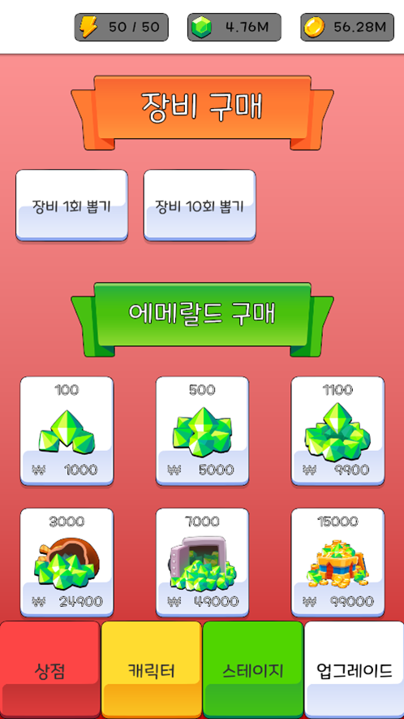 | 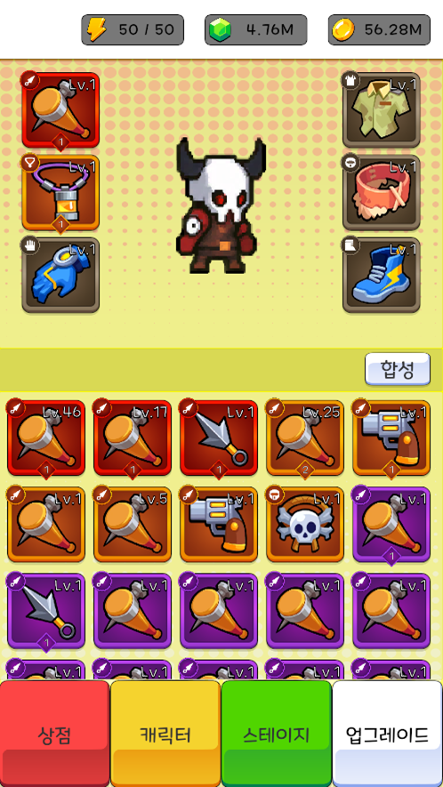 | 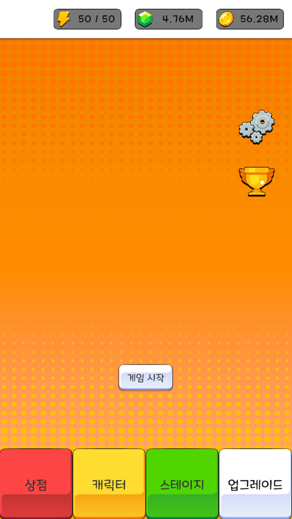 | 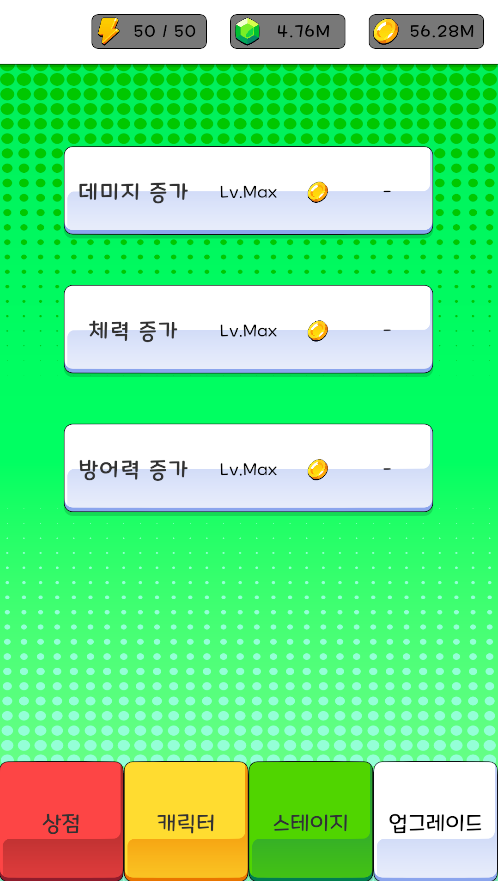 |

### 인게임 화면

| 인게임 | 능력 선택 | 경고 | 목표 도달 |
| :---: | :---: | :---: | :---: |
| 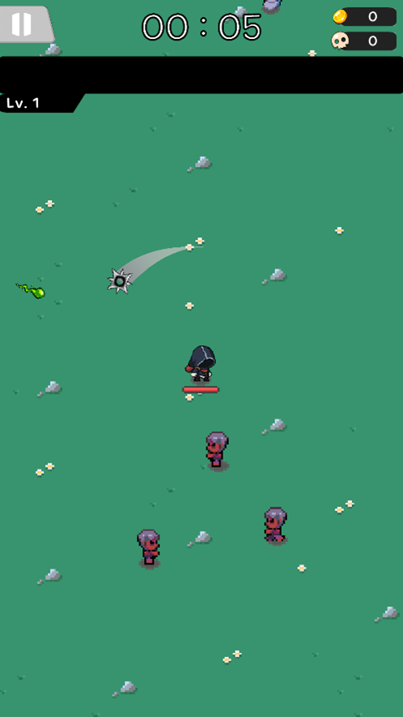 | 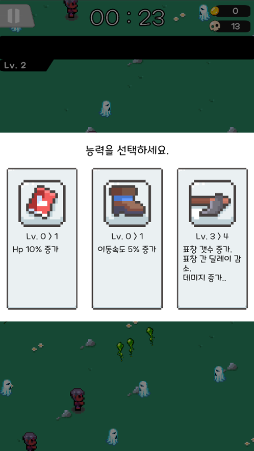 | 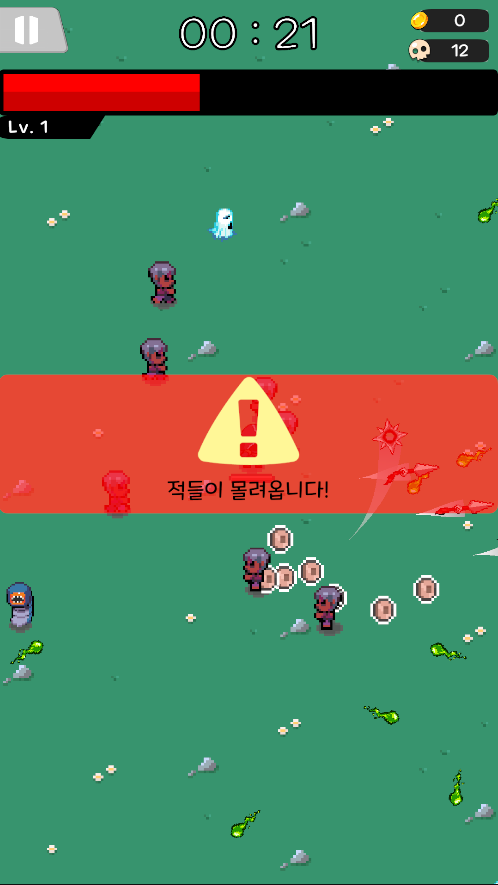 | 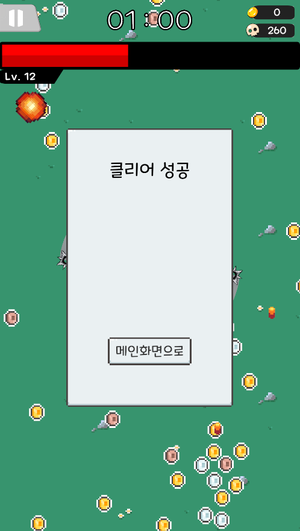 |

## 1. 프로젝트 개요

Unity 기반 2D 생존형 로그라이트 게임입니다. 로비에서 영웅 선택, 장비 관리, 합성, 영구 능력치 강화를 수행하고 전투 씬에서 조이스틱 이동과 자동 공격으로 적을 처치합니다. 경험치로 레벨을 올리며 무기·패시브를 선택하고 제한 시간 이후 등장하는 보스를 처치하면 스테이지를 클리어합니다.

전체 구조는 다음 세 축으로 구성됩니다.

- **영구 진행:** `GameData`와 도메인 모델이 재화, 장비, 영웅 선택, 업적, 에너지, 설정을 관리합니다.
- **전투 세션:** `GameSceneModel`과 `InGameHeroModel`이 시간, 처치 수, 세션 골드, 체력, 경험치와 전투 능력치를 관리합니다.
- **콘텐츠 정의:** `ScriptableObject`가 영웅·적·무기·스테이지·장비·강화 비용 등의 설정을 제공합니다.

> **Unity:** 6000.0.69f1 | **언어:** C#

## 2. 시스템 구조와 동작

### 2.1 아키텍처와 데이터 흐름

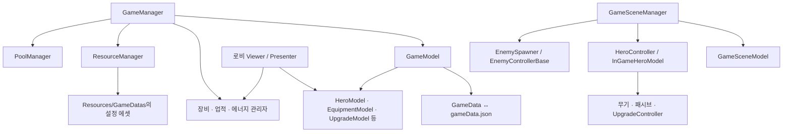

| 계층 | 핵심 타입 | 책임 |
| --- | --- | --- |
| 서비스 진입점 | `GameManager` | 전역 서비스 접근, 영속 수명 관리 |
| 영구 상태 | `GameModel`, `GameData` | 저장 상태, 도메인 모델 제공, 재화 이벤트 |
| 도메인 | `HeroModel`, `EquipmentModel`, `UpgradeModel`, `AchievementModel`, `EnergyModel`, `AppConfigModel` | 해당 저장 필드의 조회·변경 |
| 로비 표현 | `*Viewer`, `*Presenter` | UI 이벤트, 표시 갱신, 모델·관리자 호출 |
| 전투 조정 | `GameSceneManager`, `HeroController` | 세션 시작, 컴포넌트 연결, 종료 처리 |
| 콘텐츠 설정 | `SO_*`, `UpgradeData` | 밸런스와 리소스 참조 |
| 전투 행동 | 무기 컨트롤러, 적 상태 클래스 | 공격, 이동, 피격과 사망 |

### 2.2 영구 데이터와 저장

#### 2.2.1 저장 구조

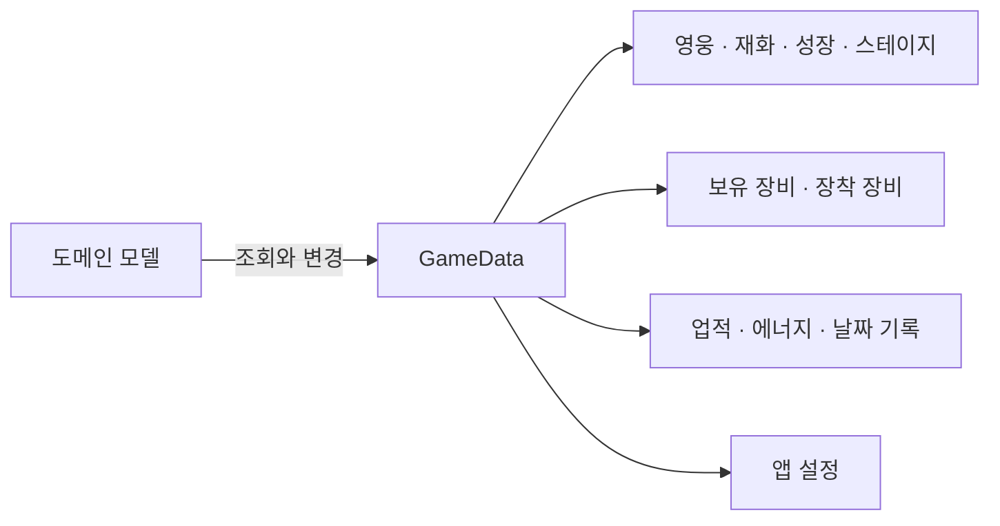

| 범주 | `GameData` 필드 |
| --- | --- |
| 영웅 | `HeroId` |
| 재화 | `Gold`, `Emerald`, `UpgradeScroll[6]` |
| 에너지 | `Energy`, `EnergyRechargeRemainingTime`, `LastLoginTime` |
| 성장·진행 | `UpgradeLevel[3]`, `MaxStage`, `SelectStage` |
| 업적 | `Achievements`, 일간·주간 점수와 리셋 날짜 |
| 장비 | `EquipmentItems`, `EquippedItems` |
| 설정 | `AppConfigData` |

#### 2.2.2 파일 경로와 저장 시점

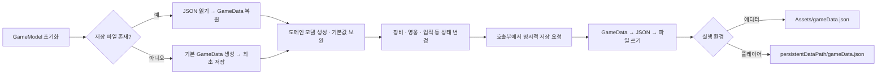

- 에디터: `Application.dataPath/gameData.json` → 프로젝트의 `Assets/gameData.json`
- 그 외 플랫폼: `Application.persistentDataPath/gameData.json`
- 직렬화: `JsonUtility.ToJson(..., true)` / `JsonUtility.FromJson<GameData>()`
- 파일 처리: 동기식 `File.ReadAllText` / `File.WriteAllText`

파일이 없으면 기본 `GameData`를 만들고 저장합니다. 이후 장비 변경, 강화, 영웅 선택, 설정 변경, 업적 보고·보상, 에너지 갱신 등의 경로에서 명시적으로 저장합니다. `AddGold()`나 `AddEmerald()` 자체는 저장하지 않으므로 호출자가 저장 시점을 책임집니다.

### 2.3 로비 시스템

#### 2.3.1 메뉴와 영웅

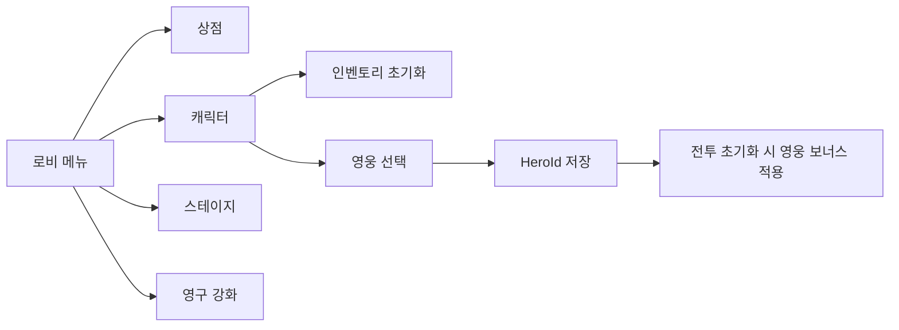

`MenuNumber`는 Shop, Character, Stage, Upgrade 순서입니다. 각 메뉴는 Model, View, Presenter를 분리하여 데이터와 UI를 분리해 유지 보수와 확장성을 추구하였으며 DOTween으로 메뉴 위치를 이동하고 캐릭터 메뉴 진입 시 인벤토리를 초기화합니다.

`HeroModel`은 `GameDatas/HeroConfigData`에서 영웅 설정을 로드하고 ID 딕셔너리를 만듭니다. ScriptableObject를 사용하여 게임 데이터를 용이하게 관리하고 영웅 변경은 ID를 저장하며 전투 초기화 시 해당 영웅 설정의 보너스 능력치가 적용됩니다.

#### 2.3.2 장비 관리와 합성

장비 데이터와 장착·강화 흐름:

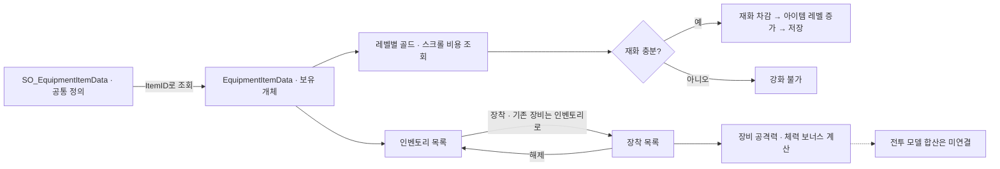

장비는 두 종류의 데이터로 나뉩니다.

- `SO_EquipmentItemData`: 공통 정의. ID, 부위, 티어, 아이콘, 등급별 기본 능력치와 레벨당 증가량.
- `EquipmentItemData`: 보유 개체. `InstanceID`, `ItemID`, 부위, 등급, 등급 내 단계, 아이템 레벨.

`EquipmentItemDatabase`는 장비 ID 조회와 부위·등급 스프라이트 조회를 제공합니다.
장착과 해제는 인벤토리 목록과 장착 목록 사이에서 개체를 이동하는 방식입니다.

장비 보너스 계산식은 `BaseStat + StatPerLevel × ItemLevel`이며 공격력과 체력을 별도로 합산합니다. 장비 관리와 전투 능력치 반영은 분리되어 있습니다.

장비 강화는 골드와 부위별 스크롤을 사용합니다. 비용은 `SO_EquipmentItemLevelUpCostConfigData`의 레벨별 테이블을 참조합니다. 등급별 기본 최대 레벨은 Common 10, UnCommon 20, Rare 30, Unique 50, Epic 80, Legendary 120, Special 200이며, 등급 내 단계마다 10레벨이 추가됩니다.

`ItemLevelUp()`는 1회 강화, `ItemLevelUpPossible()`은 가능한 만큼 실제로 강화하는 함수입니다.

장비 합성 흐름:

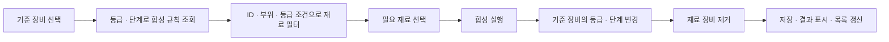

`EquipmentMergePresenter`가 합성 후보 필터링, 재료 선택, 결과 표시, 모델 값 변경을 담당합니다. `SO_MergeRuleData`는 선택한 장비의 등급·단계에 따른 재료 수와 결과 등급·단계를 제공합니다.

Rare이하 등급은 동일 ID 3개를 사용해 다음 등급으로 올립니다. Rare이상 등급은 동일 부위 재료를 통한 단계 상승과 동일 ID를 통해 등급을 상승합니다. 일괄 합성은 Common·UnCommon·Rare등급을 순차 처리합니다.

**핵심 코드 — 합성 규칙 적용과 재료 소비**

`EquipmentMergePresenter.cs`의 `Merge()`에서 결과 UI 처리를 제외한 부분입니다. 선택한 장비의 등급·단계로 규칙을 조회하고, 결과를 적용한 뒤 재료로 쓰인 장비를 제거하고 저장합니다.

```csharp
MergeRule upgradeData = _mergeRule.GetMergeRule(
    _selectedSlot.ItemData.Rarity,
    _selectedSlot.ItemData.RarityLevel);

// 결과 UI 초기화 부분 생략
_selectedSlot.ItemData.Rarity = upgradeData.UpgradedRarity;
_selectedSlot.ItemData.RarityLevel = upgradeData.UpgradedRarityLevel;

foreach (EquipmentItemSlot x in _requireItems)
{
    _model.RemoveEquipmentList(x.ItemData);
}

_model.SaveData();
```

#### 2.3.3 상점과 영구 강화

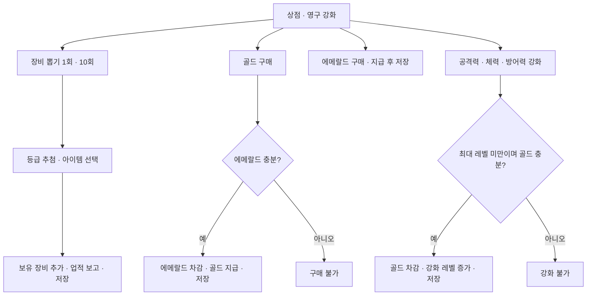

장비 뽑기는 1회·10회를 처리합니다. 등급 가중치는 Common 70, UnCommon 20, Rare 8, Unique 2입니다. 총 100.

골드 구매는 에메랄드 차감 후 골드를 지급합니다. 지급량은 `(6000 + (MaxStage - 1) × 600) × 배수`이고 배수는 2·8·24입니다. 3개의 버튼.

`UpgradeModel`은 공격력·체력·방어력의 영구 강화를 관리합니다. `UpgradeData`의 `Price`·`Value` 배열을 참조하고 각 업그레이드 최대 레벨과 업그레이드 시 골드 부족을 검사한 뒤 문제가 없다면 골드 차감·레벨 증가·저장을 수행합니다. 강화 결과는 전투 시 모델이 초기화해 적용합니다.

#### 2.3.4 업적과 에너지

업적 진행과 보상 흐름:

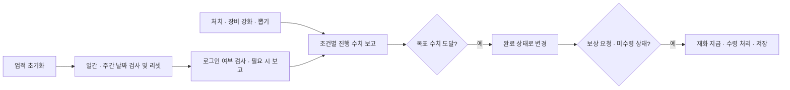

에너지 충전 흐름:

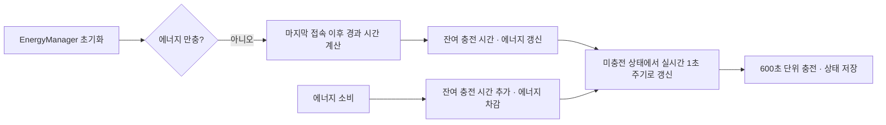

| 구분 | 일간·주간 업적 | 에너지 충전 |
| --- | --- | --- |
| 문제 | 게임을 종료한 동안에도 실제 시간은 흐르므로, 재접속 시 일간·주간 업적의 갱신 시점을 판단해야 합니다. | 게임을 실행하지 않는 동안에는 충전 타이머가 동작하지 않아 오프라인 에너지 충전량을 별도로 계산해야 합니다. |
| 해결 | 마지막 일간·주간 리셋 날짜를 저장하고, 접속 초기화 시 현재 날짜와 비교합니다. 날짜가 바뀌면 일간 업적을, 월요일 기준 새로운 주가 시작되면 주간 업적을 초기화하고 기록을 갱신합니다. | 마지막 접속 시간과 남은 충전 시간을 저장합니다. 재접속 시 현재 시간과의 차이를 계산하고, 600초 충전 주기에 따라 회복할 에너지와 남은 시간을 갱신합니다. 접속 중에는 `WaitForSecondsRealtime`으로 일시정지와 독립적으로 충전을 진행합니다. |
| 결과 | 게임을 실행하지 않은 기간이 있어도 재접속 시 현재 날짜와 주차에 맞는 업적을 제공합니다. | 오프라인에서 흐른 시간을 에너지 충전에 반영하고, 접속 후에도 남은 충전 시간을 이어서 처리합니다. |

**핵심 코드 — 조건별 업적 진행과 완료 판정**

`AchievementManager.cs`의 `Report()`는 같은 조건의 업적에 진행량을 더하고, 목표에 도달하면 완료 상태로 저장합니다.

```csharp
public void Report(AchievementConditionType conditionType, int amount = 1)
{
    foreach (var achievement in _achievementConfigDatas)
    {
        if (achievement.ConditionType != conditionType)
            continue;

        AchievementProgressData progress =
            _achievementModel.GetAchievementData(achievement.AchievementId);

        if (progress.IsRewardClaimed)
            continue;

        progress.Progress += amount;
        if (progress.Progress >= achievement.TargetValue)
        {
            progress.Progress = achievement.TargetValue;
            progress.IsCompleted = true;
        }
    }

    _achievementModel.SaveData();
}
```

**핵심 코드 — 일시정지와 독립적인 에너지 충전**

`EnergyManager.cs`의 `UpdateRemainTime()`입니다. 실제 시간 기준으로 완충까지의 남은 시간을 갱신하고, 충전 구간을 지나면 에너지를 추가하며 UI에 변경을 알립니다.

```csharp
private IEnumerator UpdateRemainTime()
{
    while (!_energyModel.IsEnergyFull)
    {
        _energyModel.AddEnergyRechargeRemainingTime(-1);
        SaveLastLoginTime();
        OnTimeChanged?.Invoke(_energyModel.EnergyRechargeRemainingTime);

        if (_remainEnergy > (_energyModel.EnergyRechargeRemainingTime / 600) + 1)
        {
            _energyModel.AddEnergy();
            _remainEnergy = _energyModel.RemainChargeEnergy;
            OnEnergyChanged?.Invoke(_energyModel.Energy, _energyModel.MaxEnergy);
        }

        yield return new WaitForSecondsRealtime(1.0f);
    }
}
```

### 2.4 전투 시스템

#### 2.4.1 전투 진행

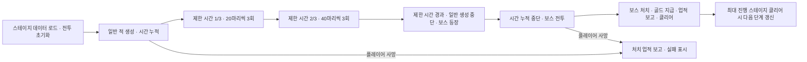

`GameSceneManager`는 선택 스테이지의 `StageData{번호}`를 읽고 영웅·적스포너·조이스틱·UI 이벤트를 연결합니다.

1. 일반 적이 스포너의 정해진 간격마다 생성됩니다.
2. 제한 시간의 1/3에서 20마리씩 3회, 2/3에서 40마리씩 3회 추가 생성합니다. 각 웨이브 간격은 3초입니다.
3. 제한 시간이 지나면 일반 생성 코루틴을 멈추고 기존 미니언을 죽음 상태로 전환한 후 보스 목록의 마지막 보스를 생성합니다.
4. 보스 등장 이후 스테이지 시간 누적을 멈춥니다.
5. 보스 처치 시 스테이지 골드를 영구 골드로 옮기고 처치 업적을 보고하며 게임을 멈추고 클리어 UI를 표시합니다.
6. 현재 최대 스테이지를 클리어했다면 최대 스테이지와 선택 스테이지를 다음 스테이지로 갱신합니다.

#### 2.4.2 플레이어 이동과 능력치

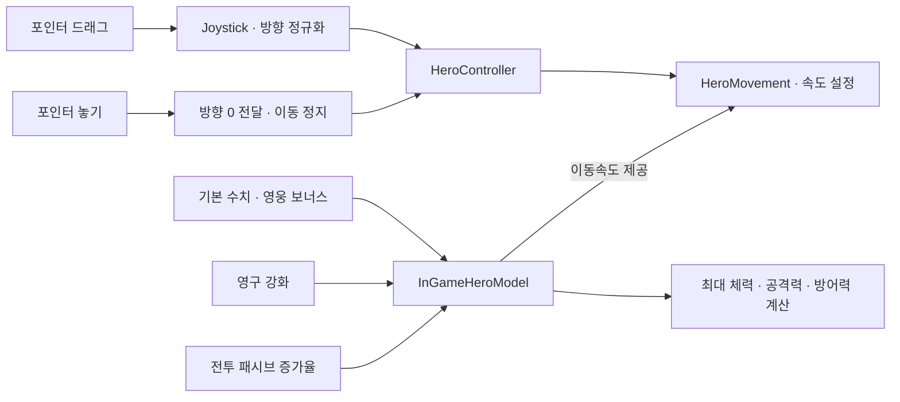

`Joystick`은 포인터 이벤트로 이동 방향을 계산하고 `HeroController`를 통해 `HeroMovement`의 `Rigidbody2D.linearVelocity`를 설정합니다. 입력 방향을 정규화해서 전달하므로 조이스틱 드래그 거리로 이동 속도를 조절하는 구조는 아닙니다. 포인터를 놓으면 속도 0을 전달합니다.

```text
MaxHp    = (기본 최대 체력 + 영구 체력 강화) × (1 + 체력 증가율 / 100)
Damage   = (기본 공격력 + 영구 공격력 강화) × (1 + 공격력 증가율 / 100)
MoveSpeed = 기본 이동속도 × (1 + 이동속도 증가율 / 100)
Armor    = 기본 방어력 + 영구 방어력 강화
```

#### 2.4.3 경험치와 성장 선택

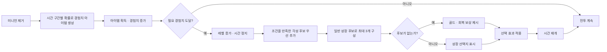

필요 경험치는 `SO_ExpConfigData`의 설정 데이터 배열에서 읽고 50레벨 이후에는 마지막 값을 사용합니다. `CheckExp()`는 호출당 한 번만 레벨을 올립니다.

`UpgradeController`는 레벨업 시 `Time.timeScale = 0`으로 정지하고 능력 선택지를 구성합니다. 기본 무기 5레벨과 요구 패시브 1레벨 이상이면 각성 선택 후보를 우선 넣고 나머지는 5레벨 미만의 성장 항목을 섞어 최대 3개의 슬롯을 채웁니다. 성장 후보가 없으면 골드·회복 같은 일회성 보상으로 대체합니다. 선택 후 시간을 `Time.timeScale = 1`로 되돌립니다.

#### 2.4.4 무기·패시브·각성

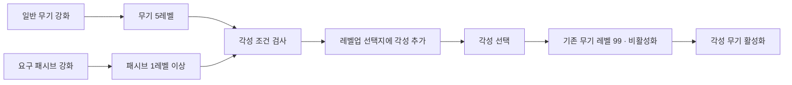

| 타입 | 역할 |
| --- | --- |
| `IUpgradable` | 아이콘, 설명, 레벨, `Upgrade()`의 공통 계약 |
| `WeaponControllerBase` | 레벨, 설정 데이터, 활성화, 공격 배율 |
| `ShootWeaponBase` | 주변 적 탐색, 발사 방향, 발사 코루틴 공통 처리 |
| `PlayerWeaponObjectBase` | 일반 적·보스 피해 계산, 충돌 판정, 풀 반환 |
| `PassiveBase`와 파생 타입 | 공격력·최대 체력·이동속도 증가 |
| `AwakeningUpgradable` | 일반 무기에서 각성 무기로 전환하는 선택 항목 |

#### 2.4.5 적과 상태 머신

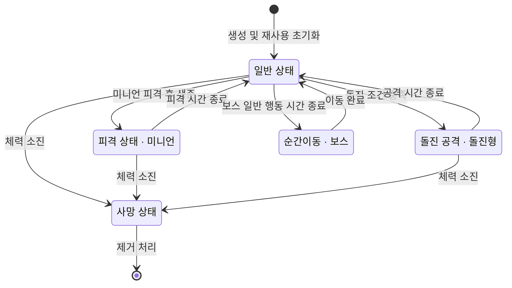

`EnemyControllerBase`는 `IState`의 진입·갱신·이탈 호출로 행동을 전환합니다. 추적형, 돌진형, 고정형 미니언과 순간이동 보스가 구현되어 있으며 정상·피격·사망·공격·이동 상태를 조합합니다.

`EnemyModel`의 최대 체력과 공격력은 스테이지별로 증가된 배율을 적용한 뒤 정수로 반올림합니다. 이동속도는 설정값을 그대로 사용합니다.

```text
스테이지 s는 최소 1
능력치 = 기본값 × (1 + s × 0.1)
               × (1 + floor(s / 10) × 0.1)
               × (1 + floor(s / 100) × 0.1)
```

미니언은 설정해둔 플레이어 반경 내의 임의 위치에 풀링 오브젝트로 생성되고, 죽음 상태 이후 경험치 생성과 풀 반환을 수행합니다. 보스는 `Instantiate`로 생성합니다.

**핵심 코드 — 상태의 진입·갱신·이탈 분리**

`IState.cs`는 적 상태의 공통 계약입니다.

```csharp
public interface IState
{
    void OnStateEnter();
    void OnStateUpdate();
    void OnStateExit();
}
```

`EnemyControllerBase.cs`에서 현재 상태를 매 프레임 갱신하고, 상태 변경 시 이전 상태의 종료와 새 상태의 진입을 순서대로 실행합니다. 사망 상태에서는 다른 상태 전환을 막습니다.

```csharp
private void Update()
{
    _curState?.OnStateUpdate();
}

public void ChangeState(IState state)
{
    if (_curState == _deadState)
        return;

    _curState?.OnStateExit();
    _curState = state;
    _curState.OnStateEnter();
}
```

### 2.5 리소스와 오브젝트 풀

리소스 캐시와 객체 대여·반환 흐름:

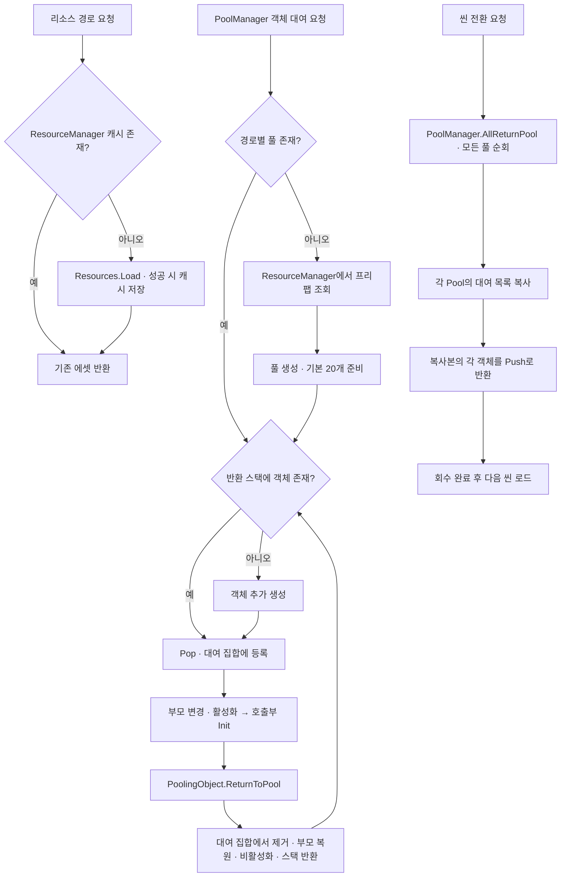

| 구분 | 내용 |
| --- | --- |
| 문제 | 게임을 한 번 플레이하고 종료하는 경우가 아니라면, 적·탄환·경험치 등 풀링 객체는 다음 플레이에서도 재사용할 수 있습니다. 하지만 사용 중인 객체가 현재 씬에 남아 있으면 씬 전환 시 함께 파괴되어 다시 생성해야 합니다. |
| 해결 | 씬을 변경하기 전에 `AllReturnPool()`로 각 씬에서 사용한 풀링 객체를 회수합니다. 객체의 부모를 씬을 넘어 유지되는 풀 컨테이너로 옮기고 비활성화해 보관합니다. |
| 결과 | 씬 전환으로 인한 객체 파괴를 방지하고, 다음 전투나 반복 플레이에서 보관한 객체를 재사용하여 불필요한 생성·파괴를 줄입니다. |

**핵심 코드 — 객체 대여·반환과 씬 전환 시 일괄 회수**

`Pool.cs`의 핵심 메서드입니다. 대여 집합으로 사용 중인 객체를 추적하고, 일괄 반환 시에는 복사본을 순회하여 반환합니다.

```csharp
public GameObject Pop(Transform parent)
{
    if (_pool.Count == 0)
        CreateObject();

    GameObject go = _pool.Pop();
    _outPoolOb.Add(go);
    go.transform.SetParent(parent);
    go.SetActive(true);
    return go;
}

public void Push(GameObject go)
{
    if (!_outPoolOb.Remove(go))
        return;

    if (go == null)
        return;

    go.transform.SetParent(_parent);
    go.SetActive(false);
    _pool.Push(go);
}

public void AllReturnPool()
{
    var borrowedObjects = new List<GameObject>(_outPoolOb);
    foreach (var go in borrowedObjects)
    {
        Push(go);
    }
}
```

## 3. 사용 에셋

| 에셋 이름 | 버전 |
| --- | --- |
| [GUI Bundle - 10 Styles](https://assetstore.unity.com/packages/2d/gui/gui-bundle-10-styles-268635) | 2.0.2 |
| [2D Cozy RPG - Farming - Tilesets - Characters - Pixelart MAIN BUNDLE](https://assetstore.unity.com/packages/2d/environments/2d-cozy-rpg-farming-tilesets-characters-pixelart-main-bundle-212921) | 3.1.5 |
