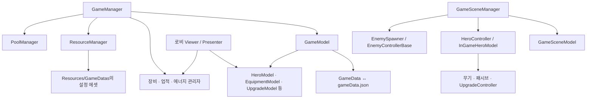

# 2D_RogueLite 기술문서

## 1. 프로젝트 개요

Unity 기반 2D 생존형 로그라이트 게임이다. 로비에서 영웅 선택, 장비 관리, 합성, 영구 능력치 강화를 수행하고 전투 씬에서 조이스틱 이동과 자동 공격으로 적을 처치한다. 경험치로 레벨을 올리며 무기·패시브를 선택하고, 제한 시간 이후 등장하는 보스를 처치하면 스테이지를 클리어한다.

전체 구조는 다음 세 축으로 구성된다.

- **영구 진행:** `GameData`와 도메인 모델이 재화, 장비, 영웅 선택, 업적, 에너지, 설정을 관리한다.
- **전투 세션:** `GameSceneModel`과 `InGameHeroModel`이 시간, 처치 수, 세션 골드, 체력, 경험치와 전투 능력치를 관리한다.
- **콘텐츠 정의:** `ScriptableObject`가 영웅·적·무기·스테이지·장비·강화 비용 등의 설정을 제공한다.

## 2. 개발 환경과 의존성

| 항목 | 사용 버젼 |
| --- | --- |
| Unity | 6000.0.69f1 |
| 언어 | C# |
| 렌더링 | URP 17.0.4, 2D Renderer 설정 에셋 |
| 카메라 패키지 | Cinemachine 3.1.6 |
| 입력 패키지 | Input System 1.19.0 |
| 트윈 | DOTween 소스 포함 |

## 3. 아키텍처와 데이터 흐름



| 계층 | 핵심 타입 | 책임 |
| --- | --- | --- |
| 서비스 진입점 | `GameManager` | 전역 서비스 접근, 영속 수명 관리 |
| 영구 상태 | `GameModel`, `GameData` | 저장 상태, 도메인 모델 제공, 재화 이벤트 |
| 도메인 | `HeroModel`, `EquipmentModel`, `UpgradeModel`, `AchievementModel`, `EnergyModel`, `AppConfigModel` | 해당 저장 필드의 조회·변경 |
| 로비 표현 | `*Viewer`, `*Presenter` | UI 이벤트, 표시 갱신, 모델·관리자 호출 |
| 전투 조정 | `GameSceneManager`, `HeroController` | 세션 시작, 컴포넌트 연결, 종료 처리 |
| 콘텐츠 설정 | `SO_*`, `UpgradeData` | 밸런스와 리소스 참조 |
| 전투 행동 | 무기 컨트롤러, 적 상태 클래스 | 공격, 이동, 피격과 사망 |

## 4. 영구 데이터와 저장

### 4.1 저장 구조

| 범주 | `GameData` 필드 |
| --- | --- |
| 영웅 | `HeroId` |
| 재화 | `Gold`, `Emerald`, `UpgradeScroll[6]` |
| 에너지 | `Energy`, `EnergyRechargeRemainingTime`, `LastLoginTime` |
| 성장·진행 | `UpgradeLevel[3]`, `MaxStage`, `SelectStage` |
| 업적 | `Achievements`, 일간·주간 점수와 리셋 날짜 |
| 장비 | `EquipmentItems`, `EquippedItems` |
| 설정 | `AppConfigData` |

### 4.2 파일 경로와 저장 시점

- 에디터: `Application.dataPath/gameData.json` → 프로젝트의 `Assets/gameData.json`
- 플레이어: `Application.persistentDataPath/gameData.json`
- 직렬화: `JsonUtility.ToJson(..., true)` / `JsonUtility.FromJson<GameData>()`
- 파일 처리: 동기식 `File.ReadAllText` / `File.WriteAllText`

파일이 없으면 기본 `GameData`를 만들고 저장한다. 이후 장비 변경, 강화, 영웅 선택, 설정 변경, 업적 보고·보상, 에너지 갱신 등의 경로에서 명시적으로 저장한다. `AddGold()`나 `AddEmerald()` 자체는 저장하지 않으므로 호출자가 저장 시점을 책임진다. 전역 종료·포커스 변경 자동 저장은 확인하지 못했다.

현재 저장 형식에는 스키마 버전, 손상 복구, 백업, 원자적 파일 교체가 없다. 최초 값 보완은 일부 필드에만 적용된다. 에디터 저장 파일은 Git 추적 대상이므로 플레이 테스트가 공유 데이터 변경으로 이어질 수 있다. 초기화 테스트 전에는 원본을 백업한다.

## 5. 로비 시스템

### 5.1 메뉴와 영웅

`MenuNumber`는 Shop, Character, Stage, Upgrade 순서다. `MenuPresenter`는 DOTween으로 메뉴 위치를 이동하고 캐릭터 메뉴 진입 시 인벤토리를 초기화한다. 이동 간격에 `1080`이 하드코딩되어 있어 UI 해상도·좌표계 변경 시 확인이 필요하다.

`HeroModel`은 `GameDatas/HeroConfigData`에서 영웅 설정을 로드하고 ID 딕셔너리를 만든다. 현재 영웅 설정 에셋은 `00`, `01`, `02`의 3개다. 영웅 변경은 ID를 저장하며 전투 초기화 시 해당 설정의 공격력·이동속도·최대 체력 보너스가 적용된다.

### 5.2 장비

장비는 두 종류의 데이터로 나뉜다.

- `SO_EquipmentItemData`: 공통 정의. ID, 부위, 티어, 아이콘, 등급별 기본 능력치와 레벨당 증가량.
- `EquipmentItemData`: 보유 개체. `InstanceID`, `ItemID`, 부위, 등급, 등급 내 단계, 아이템 레벨.

현재 `GameDatas/ItemData`에는 6부위 × 3개의 정의 에셋이 있다. `EquipmentItemDatabase`는 ID 조회와 부위·등급 스프라이트 조회를 제공한다. 장착과 해제는 인벤토리 목록과 장착 목록 사이에서 개체를 이동하는 방식이다.

장비 보너스 계산식은 `BaseStat + StatPerLevel × ItemLevel`이며 공격력과 체력을 별도로 합산한다. 다만 `EquipmentBonusAtk`와 `EquipmentBonusHp`는 분석한 자체 코드에서 다른 소비 지점이 확인되지 않았고, `InGameHeroModel` 초기화에도 합산되지 않는다. 장비 관리와 전투 능력치 반영은 현재 분리되어 있다.

장비 강화는 골드와 부위별 스크롤을 사용한다. 비용은 `SO_EquipmentItemLevelUpCostConfigData`의 레벨별 테이블을 참조한다. 등급별 기본 최대 레벨은 Common 10, UnCommon 20, Rare 30, Unique 50, Epic 80, Legendary 120, Special 200이며, 등급 내 단계마다 10이 추가된다.

`ItemLevelUp()`는 1회 강화, `ItemLevelUpPossible()`은 가능한 만큼 실제로 강화하는 함수다. 후자는 이름과 달리 조회가 아닌 상태 변경이며, 저장은 호출부에서 수행한다. 1회 강화 함수 내부에는 최대 레벨 검사가 없어 UI 외부에서 재사용할 때 별도 검사가 필요하다.

### 5.3 장비 합성

`EquipmentMergePresenter`가 후보 필터링, 재료 선택, 결과 표시, 모델 변경을 담당한다. `SO_MergeRuleData`는 입력 등급·단계에 따른 재료 수와 출력 등급·단계를 제공한다. 일부 재료 일치 조건은 Presenter에 직접 구현되어 있어 규칙 에셋만 바꿔 모든 합성 동작을 변경할 수는 없다.

낮은 등급은 동일 ID 3개를 사용해 다음 등급으로 올린다. 상위 등급은 동일 부위 재료를 통한 단계 상승과 동일 ID를 통한 등급 상승을 조합한다. 정확한 전이는 `GameDatas/MergeRuleData/MergeRuleData.asset`와 `SortRequireSlots()`를 함께 확인해야 한다. 일괄 합성은 Default 티어의 Common·UnCommon·Rare를 순차 처리한다.

### 5.4 상점과 영구 강화

장비 뽑기는 1회·10회를 처리한다. `Fifty` enum은 있으나 실행 분기가 없다. 등급 가중치는 Common 70, UnCommon 20, Rare 8, Unique 2다. 티어 추첨 함수는 존재하지만 반환된 티어가 아이템 풀 필터에 사용되지 않아 실제 선택에는 반영되지 않는다. 뽑기 비용 검사와 차감도 구현되어 있지 않다.

골드 구매는 에메랄드 차감 후 골드를 지급한다. 지급량은 `(6000 + (MaxStage - 1) × 600) × 배수`이고 배수는 2·8·24다. 에메랄드 구매는 설정된 수량을 바로 더하며 실제 결제 검증은 없다.

`UpgradeModel`은 공격력·체력·방어력의 영구 강화를 관리한다. `UpgradeData`의 `Price`·`Value` 배열을 참조하고, 최대 레벨과 골드 부족을 검사한 뒤 차감·레벨 증가·저장을 수행한다. 강화 결과는 전투 모델이 초기화 시 읽는다.

### 5.5 업적과 에너지

`AchievementModel.Init()`은 설정에 존재하는 업적의 진행 데이터를 보완한다. `AchievementManager`는 조건별 보고, 완료 판정, 중복 수령 방지와 골드·에메랄드·스크롤 보상을 처리한다. 초기화 시 기기 로컬 날짜로 일간 리셋과 월요일 기준 주간 리셋을 검사한다. 장시간 실행 중 날짜 변경을 계속 감시하는 흐름은 확인하지 못했다.

업적 보고가 확인된 경로는 로그인, 일반 적 처치, 보스 처치, 장비 강화, 장비 뽑기다. 스테이지 입장 업적 에셋은 있으나 `StageMenuManager`에는 해당 보고 호출이 없다.

에너지는 최대값 50, 충전 단위 600초로 구현되어 있다. 오프라인 시간은 `DateTime.Now`와 바이너리 문자열로 저장한 `LastLoginTime`의 차이로 계산한다. 온라인 충전은 `WaitForSecondsRealtime(1)`을 사용하여 전투 일시정지와 독립적으로 진행한다. 현재 스테이지 입장 조건과 소비량은 모두 0으로 설정되어 있다.

## 6. 전투 시스템

### 6.1 전투 진행

`GameSceneManager`는 선택 스테이지의 `StageData{번호}`를 읽고 영웅·스포너·조이스틱·UI 이벤트를 연결한다.

1. 일반 적이 스포너의 직렬화된 간격마다 생성된다.
2. 제한 시간의 1/3에서 20마리씩 3회, 2/3에서 40마리씩 3회 추가 생성한다. 각 웨이브 간격은 3초다.
3. 제한 시간이 지나면 일반 생성 코루틴을 멈추고 기존 미니언을 죽음 상태로 전환한 후 보스 목록의 마지막 보스를 생성한다.
4. 보스 등장 이후 스테이지 시간 누적을 멈춘다.
5. 보스 처치 시 세션 골드를 영구 골드로 옮기고 처치 업적을 보고하며 게임을 멈추고 클리어 UI를 표시한다.
6. 현재 최대 스테이지를 클리어했다면 최대 스테이지와 선택 스테이지를 다음 번호로 갱신한다.

현재 스테이지 에셋은 1~6이며 제한 시간은 모두 60초다. 최대 스테이지 증가에는 콘텐츠 상한 검사가 없어 6 클리어 이후 7번 데이터 조회가 실패할 수 있다.

플레이어 사망 시 처치 업적을 보고하고 실패 UI를 표시한다. 실패 처리에는 세션 골드의 영구 지급이 없다. 전투 중 중도 종료 경로 역시 처치 업적 보고 없이 로비로 이동한다. 일반 적 처치 자체가 골드를 올리지는 않으며, 확인한 세션 골드 증가 경로는 `AbilityGold`의 50골드 보상이다.

### 6.2 플레이어 이동과 능력치

`Joystick`은 포인터 이벤트로 방향을 계산하고 `HeroController`를 통해 `HeroMovement`의 `Rigidbody2D.linearVelocity`를 설정한다. 입력 방향을 정규화하므로 드래그 거리로 이동 속도를 조절하는 구조는 아니다. 포인터를 놓으면 속도 0을 전달한다.

`InGameHeroModel`의 초기값은 레벨 1, 기본 최대 체력 10000, 기본 공격력 1, 기본 이동속도 2다. 영구 강화와 선택 영웅의 보너스를 반영하며 주요 식은 다음과 같다.

```text
MaxHp    = (기본 최대 체력 + 영구 체력 강화) × (1 + 체력 증가율 / 100)
Damage   = (기본 공격력 + 영구 공격력 강화) × (1 + 공격력 증가율 / 100)
MoveSpeed = 기본 이동속도 × (1 + 이동속도 증가율 / 100)
Armor    = 기본 방어력 + 영구 방어력 강화
```

`Armor`는 계산되지만 `TakeDamage()`는 입력 피해를 그대로 현재 체력에서 뺀다. 체력 회복은 계산된 `MaxHp` 대신 기본 `_maxHp`를 상한으로 사용한다. `OnChangeHp`는 선언·구독되어 있지만 피격·회복 함수에는 발행 호출이 없다.

### 6.3 경험치와 성장 선택

미니언 제거 시 경험치 아이템을 생성한다. 경험치 종류별 값은 10·20·50이고, 시간 구간별 확률은 `SO_ExpProbabilityConfigData`가 제공한다. 획득 충돌 태그는 코드상 `Magnatic`이다. 오타처럼 보이더라도 현재 에셋 계약이므로 코드와 에셋을 함께 바꿔야 한다.

필요 경험치는 `SO_ExpConfigData`의 배열에서 읽고 50레벨 이후에는 마지막 값을 사용한다. `CheckExp()`는 호출당 한 번만 레벨을 올린다. 한 번에 여러 레벨 분량을 획득하면 남은 경험치를 재검사하는 흐름이 추가로 필요하다.

`UpgradeController`는 레벨업 시 `Time.timeScale = 0`으로 정지하고 선택지를 구성한다. 기본 무기 5레벨과 요구 패시브 1레벨 이상이면 각성 후보를 우선 넣고, 나머지는 5레벨 미만의 성장 항목을 섞어 최대 3개를 채운다. 성장 후보가 없으면 골드·회복 같은 일회성 보상으로 대체한다. 선택 후 시간을 1로 되돌린다.

### 6.4 무기·패시브·각성

| 타입 | 역할 |
| --- | --- |
| `IUpgradable` | 아이콘, 설명, 레벨, `Upgrade()`의 공통 계약 |
| `WeaponControllerBase` | 레벨, 설정 데이터, 활성화, 공격 배율 |
| `ShootWeaponBase` | 주변 적 탐색, 발사 방향, 발사 코루틴 공통 처리 |
| `PlayerWeaponObjectBase` | 일반 적·보스 피해 계산, 충돌 판정, 풀 반환 |
| `PassiveBase`와 파생 타입 | 공격력·최대 체력·이동속도 증가 |
| `AwakeningUpgradable` | 일반 무기에서 각성 무기로 전환하는 선택 항목 |

권총·소총·샷건·투척 계열·쿠나이 코드와 권총·삽 각성 코드가 존재한다. 코드명 `WeaponThrowingStar`, 설정 파일명, `WeaponType.Shovel` 등의 명칭은 완전히 통일되어 있지 않아 타입과 에셋 연결을 함께 확인해야 한다.

시작 무기는 장착 무기와 무관하게 자식 무기 배열의 첫 항목을 강화한다. 각성 시 기존 무기를 비활성화하고 레벨을 99로 설정한 뒤 각성 무기를 활성화한다. 일반 성장 상한 5와 각성 표식 99가 여러 코드에 직접 사용되므로 확장 시 공통 규칙으로 정리할 필요가 있다.

탄환 피해는 발사체 초기화 시 모델에서 계산한다. 이때 `Damage`에 포함된 공격력 증가율을 한 번 더 곱하는 경로가 있다. 치명타 여부는 50% 무작위 플래그로 정하지만, 공통 탄환 피해 계산에서 치명타 배율은 적용하지 않는다.

### 6.5 적과 상태 머신

`EnemyControllerBase`는 `IState`의 진입·갱신·이탈 호출로 행동을 전환한다. 추적형, 돌진형, 고정형 미니언과 순간이동 보스가 구현되어 있으며 정상·피격·사망·공격·이동 상태를 조합한다.

`EnemyModel`의 최대 체력과 공격력은 다음 배율을 적용한 뒤 정수로 반올림한다. 이동속도는 설정값을 그대로 사용한다.

```text
스테이지 s는 최소 1
능력치 = 기본값 × (1 + s × 0.1)
               × (1 + floor(s / 10) × 0.1)
               × (1 + floor(s / 100) × 0.1)
```

미니언은 플레이어 반경 10의 임의 방향에 풀에서 생성되고, 죽음 상태 이후 경험치 생성과 풀 반환을 수행한다. 보스는 `Instantiate`로 생성한다. 순간이동 보스는 8방향 발사와 나선형 탄환 패턴을 갖는다.

### 6.6 일시정지와 배경

일시정지·성장 선택·전투 종료 모두 `Time.timeScale`을 직접 제어한다. 중앙의 정지 사유 관리가 없어 팝업이 겹치는 기능을 추가할 때 한 화면의 재개가 다른 화면의 정지를 풀지 않도록 주의해야 한다. 로비 복귀 경로에서는 1로 복원한다.

## 7. 리소스와 오브젝트 풀

`ResourceManager`는 경로 문자열을 키로 프리팹과 ScriptableObject를 캐시한다. 일부 도메인 모델은 이 서비스를 거치지 않고 `Resources.Load`·`LoadAll`을 직접 사용한다. 경로는 `Assets/Resources` 기준이며 확장자를 제외한다.

| 용도 | 경로 계약 예시 |
| --- | --- |
| 스테이지 | `GameDatas/StageData/StageData{SelectStage}` |
| 적 설정 | `GameDatas/EnemyConfigData/Minion/{프리팹명}_ConfigData` |
| 보스 설정 | `GameDatas/EnemyConfigData/Boss/{프리팹명}_ConfigData` |
| 일반 적 프리팹 | `Prefabs/Enemies/Minion/{프리팹명}` |
| 경험치 | `Prefabs/Item/Item_Exp` |
| 피해 숫자 | `Prefabs/DamageFloater/DamageFloater` |
| 장비 슬롯 | `Prefabs/Slots/ItemSlot` |

`PoolManager`는 경로별 `Pool`을 만들며 기본 20개를 미리 생성한다. 반환 객체는 `Stack<GameObject>`, 대여 객체는 `HashSet<GameObject>`로 관리한다. 재고가 없으면 추가 생성한다. `PoolingObject.ReturnToPool()`이 반환 진입점이다.

풀 컨테이너는 씬을 넘어 유지된다. 대여 시에는 요청한 부모로 옮기고 활성화한 뒤 호출자가 `Init()`을 실행한다. 따라서 `OnEnable()`이 `Init()`보다 먼저 실행될 수 있으며 재사용 상태는 초기화 시 명시적으로 리셋해야 한다.

현재 `Pool.AllReturnPool()`은 빈 함수다. `LoadSceneManager`가 씬 이동 전에 호출해도 실제 일괄 반환은 일어나지 않는다. 대여 객체가 씬 소속 부모와 함께 파괴되면 유지되는 풀의 대여 집합에 파괴된 참조가 남을 수 있다. 대여 목록 복사 후 반환, 중복 반환 방지, 파괴 참조 정리를 함께 설계해야 한다.
